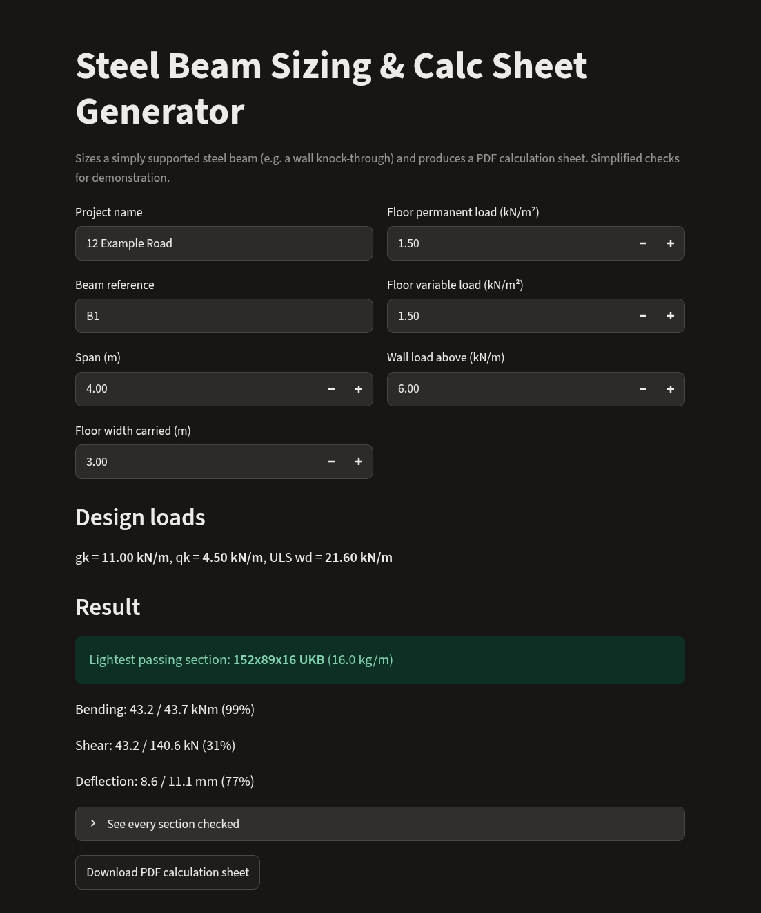
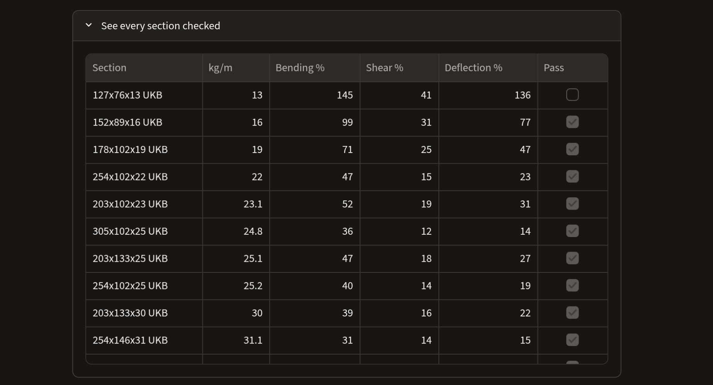
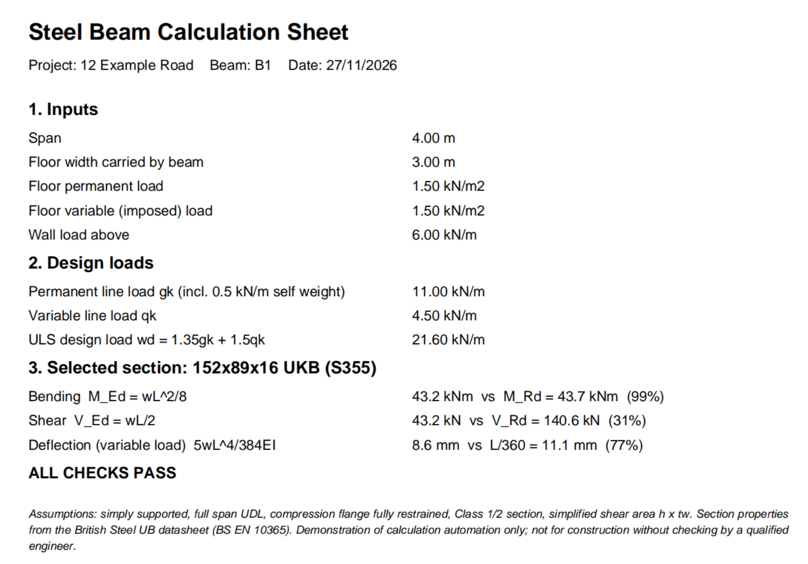

# Steel Beam Sizing & Calc Sheet Generator

**Live app:** <https://beam-calc-ahmed.streamlit.app>

## The problem
In residential refurbishment work, engineers repeatedly size the same element: a simply supported steel beam where a wall is removed. Each time the loads are worked out, sections are checked by hand or in a spreadsheet, and the result is typed up into a calculation sheet. It is repetitive, and every manual step is a chance for a transcription error.

## My approach
I split the job into three parts, each in its own file:
1. `sections.py`: a table of UK Beam (UKB) sections and their properties, taken from the British Steel UB datasheet (BS EN 10365).
2. `calc.py`: works out the design loads (1.35 permanent + 1.5 variable), then checks bending, shear and deflection for every section and picks the lightest one that passes.
3. `report.py`: turns the inputs and results into a one page PDF calculation sheet.

`app.py` puts it all behind a simple web form built with Streamlit.

## What it does
- Takes span, floor loads, the width of floor carried and any wall load above.
- Shows the design loads, the lightest passing section and its utilisation for each check.
- Shows every section it tried, so the choice is transparent.
- Produces a downloadable PDF calc sheet straight away.

## How I checked it
I verified the test case (4 m span, 152x89x16 UKB selected at 99% bending) with a hand calculation, and checked the section properties against the manufacturer's datasheet, correcting the values I had first entered. Full working: [HAND_CHECK.md](HAND_CHECK.md)

## Outcome
A beam check and its calc sheet are produced in under a minute, in the same format every time, with no retyping of numbers between the calculation and the report.

## Assumptions and limits
Simply supported, full span UDL, compression flange fully restrained (no lateral torsional buckling check), Class 1/2 sections, simplified shear area, 0.5 kN/m self weight allowance, deflection under variable load limited to span/360. Built to demonstrate calculation and report automation, not for construction use without checking by a qualified engineer.

## Next steps I would add
Point loads, lateral torsional buckling, padstone/bearing checks, more section types, and saving each calc into a project folder.

## Run it yourself
```
pip install -r requirements.txt
streamlit run app.py
```

Note: the free hosted app goes to sleep when unused. If you see a "wake up" button, it starts in about 30 seconds.

## Screenshots
**The app:** enter the beam and loads, get the lightest passing section instantly





**Every section checked:** shows why the selected beam was chosen





**Generated PDF calculation sheet**




Built by Ahmed El Bala, BEng Mechanical Engineering (University of Southampton), using Python with AI-assisted coding.
